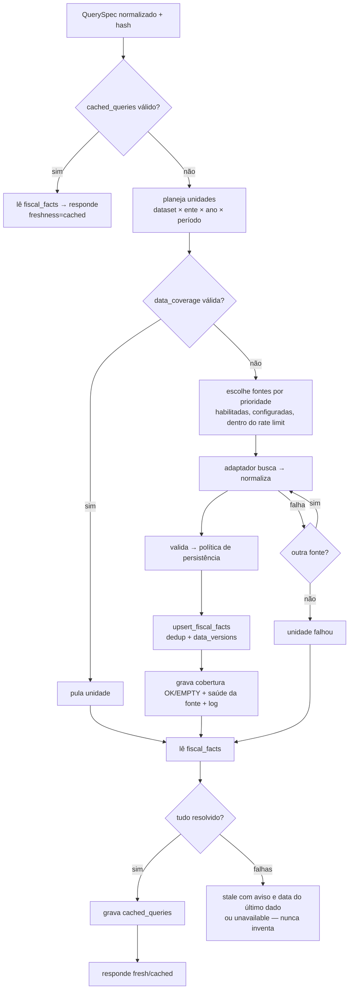

# Arquitetura

## Visão

```
Usuário → Frontend (Next.js) → Brasil Fiscal API (/api/v1) → Query Router → Repositories / Adapters → Supabase ou API governamental
```

O frontend **nunca** conhece a estrutura física das fontes nem chama APIs governamentais. Todo número chega com sua proveniência (fonte, dataset, competência, data de coleta, link oficial).

### Fluxo de uma consulta



Pontos-chave:

* **Cobertura por unidade** (`data_coverage`) é o que permite reaproveitamento: a consulta “2022–2023” aproveita o ano 2023 já buscado por outra consulta. `cached_queries` é o atalho de consulta, chaveado pelo hash do **QuerySpec normalizado** (perguntas equivalentes ⇒ mesma chave).
* **Persistimos fatos estruturados** (`fiscal_facts`), nunca “pergunta/resposta”.
* **Fonte desativada**: nenhuma chamada externa; dados e cache existentes continuam servidos (`stale` + aviso).
* **Fonte offline**: usa o último dado salvo e informa a data; sem dado salvo ⇒ “indisponível”.
* **Orçamento por consulta** (14 unidades / 25 s): o excedente retorna `partial` e se completa nas consultas seguintes — compatível com funções serverless.
* **Cache negativo**: unidade sem dados na fonte vira `EMPTY` com TTL curto.
* **TTL**: `cache_ttl_minutes` da fonte; anos fechados há > 1 ano ×7.

## Camadas e contratos (`src/server`)

| Módulo | Papel |
|---|---|
| `core/interfaces.ts` | `IGovernmentSource`, `IDataRepository`, `ICacheRepository`, `ISourceRegistry`, `IAnalyticsRepository`, `IQueryEngine` |
| `core/query-spec.ts` | contrato de consulta (zod) + normalização + hash |
| `core/datasets.ts` | catálogo de datasets (unidade de busca e de cobertura) |
| `router/` | `QueryRouter`, `CatalogService` (cadastro de entes com fallback), `validate`, `SourceRuntime` (credencial + HTTP com log/rate limit) |
| `sources/` | adaptadores: `siconfi`, `transparencia`, `dataset-download` (Receita/Tesouro), `dadosgov`, `ibge` + `http.ts` (timeout, retry controlado, redação de segredos) |
| `repositories/supabase/` | implementações Supabase das interfaces |
| `services/` | `source-admin`, `overview`, `views` (agregação/“R$100”), `ask`, `search` |
| `intent/` | parser de linguagem natural → Intent JSON → validador → QuerySpec |
| `container.ts` | **único** lugar que conhece implementações concretas |
| `dev/` | repositórios em memória + fixtures (**apenas** testes e modo dev) |

### Crescer sem mudar o frontend

O contrato é o HTTP `/api/v1/*` e os DTOs de `src/lib/dto.ts`. Trocar implementações acontece em `container.ts`:

* **Redis** na frente de `ICacheRepository` (consulta e cobertura) e do rate limit;
* **ClickHouse/Parquet** como `IDataRepository`/`IAnalyticsRepository` para agregações; o Supabase segue como registro/auth;
* **Workers externos**: o `QueryRouter` já separa “planejar” de “buscar”; a busca (`fetchWithFallback`) pode virar fila (`partial` já é parte do contrato);
* **API independente**: as rotas são finas (`handle` + serviço). Páginas server-side usam `lib/server-api.ts`, que hoje chama os serviços em processo e pode virar `fetch(API_BASE_URL)` sem tocar nas páginas.

Decisão: a API é **Next Route Handlers** (e não Edge Functions Deno) para manter **um** código TypeScript testável localmente. A lógica é independente de runtime; `pg_cron`/Vercel Cron chamam `/api/cron/health` (ver SECURITY.md).

## Conceitos contábeis (nunca misturados)

`REVENUE_FORECAST`, `REVENUE_REALIZED`, `EXPENSE_BUDGETED/COMMITTED/LIQUIDATED/PAID`, `TRANSFER`, `DEBT`, `BENEFIT_VALUE`, `BENEFICIARIES`, `CONTRACT_VALUE`, `FISCAL_INDICATOR` — enum distinto no banco, rótulos e glossário próprios na UI. Fluxos somam no período; saldos (`DEBT`, `BENEFICIARIES`) usam o último período do ano.

* *Total de despesa* = soma das funções (partição exclusiva); *total de receita* = receitas correntes + de capital (nível 1 da natureza), exceto intraorçamentárias. O cartão “Resultado” é explicitamente “receita arrecadada − despesa liquidada”.
* Linhas intraorçamentárias da DCA são ignoradas para evitar dupla contagem.

## Frontend

Mobile-first, tokens em `globals.css` (`@theme`), gráficos Recharts em *code splitting* (`dynamic`), tabela equivalente para leitores de tela, ajuda contextual (`Help`) e glossário, `SourceNote` em todo gráfico/indicador. Páginas públicas são renderizadas no servidor (SEO, `generateMetadata`); gráficos/filtros buscam `/api/v1` no cliente. Respostas completas têm `Cache-Control: s-maxage`; degradadas, `no-store`.

## Observabilidade

`api_request_logs` registra cada chamada externa (endpoint sem segredos, status, duração, registros recebidos/salvos, erro) e cada consulta do router (`query_type='router'`, hit/miss). O dashboard calcula consultas, hits/misses, chamadas externas, erros, latência média, top fontes/municípios/indicadores e uso do banco (níveis: <60% normal, 60–75% atenção, 75–85% alerta, >85% crítico).
